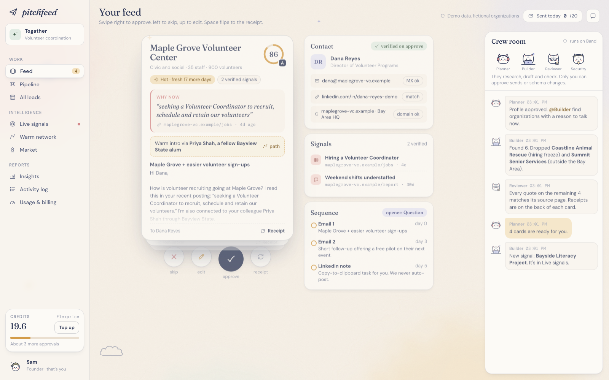
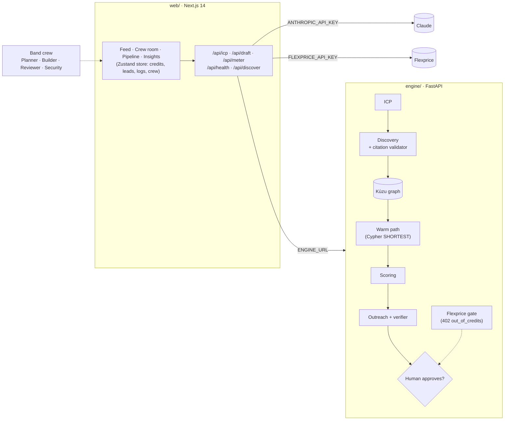

# Pitchfeed

> **Swipe right on your first customers.** An honest go-to-market engine for first-time founders: it finds organizations with a real reason to talk right now, shows the warm path to the buyer, drafts a note from one cited signal, and lets you approve each send with a swipe. Every claim comes with a receipt.


<!-- Screenshot placeholder: drop a 1600×1000 capture of the Feed view at docs/screenshots/feed.png -->

**Demo data, fictional organizations.** The demo product is *Togather*, a volunteer-coordination app selling to Kiwanis clubs, volunteer centers and nonprofits.

## Why it wins

1. **AI SDRs failed by spamming made-up, generic messages.** Pitchfeed sends *few, true, well-timed* messages, and drops any claim it can't cite.
2. **Founders without a network don't know their warm paths.** The graph finds "you → alum → buyer".
3. **Approving outreach is fun** (swipe), so the human actually stays in the loop. Only a human can approve a send.

## Features mapped to the judging criteria

| Criterion | Where to look in Pitchfeed |
|---|---|
| **ICP & Discovery** (20%) | Intake → crew "thinking" constellation → ICP cards with confidence bars per field, rule-outs, messaging rules per persona, and adjacent segments you can add or skip. `/api/icp` turns the intake into ICP JSON with Claude. Every lead carries verbatim, sourced signals. |
| **Enrichment & Outreach** (20%) | Verified email + MX badge on approve, 3-touch sequence (Email 1, Email 2, LinkedIn task), drafts built from one cited signal (`/api/draft` refuses a live draft that drops the quote), edit sheet with live checks that **block** hype, missing quotes and outside links. Proof receipt on the back of every card. |
| **Dashboard & Lead Mgmt** (15%) | Drag-and-drop pipeline with you/crew attribution, filterable leads table with CSV export, live signals radar, warm-network graph, market map, insights (funnel, A/B opener test, reply rate by industry and tier), activity log, Founder Wrapped. |
| **Startup Viability** (15%) | Wedge: founders with a product but no sales network. Pricing: pay per lead you act on (credits), not per seat. Daily send cap protects the founder's domain. |
| **Tech & Demo** (10%) | Every integration is live with a key and demo without one; `/api/health` reports which. Runs with zero env keys. Tested FastAPI engine with Kùzu graph, citation validator and HITL gate. |
| **Band bonus** | Crew room: Planner, Builder, Reviewer and Security agents talk in a Band room, @mention each other, flag "waiting on you", and ask for human approval of graph schema changes. Approvals by a non-human actor are rejected and logged. |
| **Flexprice bonus** | Every graph query (0.1), enrichment (5) and send (1) is metered (`/api/meter` → Flexprice events). Approval is blocked below 6 credits (HTTP 402 in the engine, credit modal in the UI); cost shows on every receipt and in Usage & billing. |

## Architecture



More detail in [docs/ARCHITECTURE.md](docs/ARCHITECTURE.md). Demo shot list in [docs/DEMO_SCRIPT.md](docs/DEMO_SCRIPT.md).

## Run it

### Web (zero keys needed)

```bash
cd web
npm install
npm run dev        # http://localhost:3000
```

Production build: `npm run build && npm start`. To go live, copy `.env.example` to `web/.env.local` and fill any keys.

### Engine (optional)

```bash
cd engine
python -m venv .venv && source .venv/bin/activate
pip install -r requirements.txt
uvicorn app.main:app --reload   # http://localhost:8000/health
pytest -q
```

Then set `ENGINE_URL=http://localhost:8000` in `web/.env.local` so `/api/discover` proxies to it.

## Live vs demo

| Integration | Live when | Demo fallback |
|---|---|---|
| Claude (ICP + drafts) | `ANTHROPIC_API_KEY` set | Built-in demo ICP and drafts |
| Flexprice metering | `FLEXPRICE_API_KEY` set | Local ledger only (UI always updates) |
| FastAPI engine | `ENGINE_URL` reachable | Demo leads in `web/lib/demo-data.ts` |
| Tavily / Hunter / SendGrid (engine) | keys in `engine/.env` | Seeded demo candidates, demo inbox |

Check it any time: `GET /api/health` (web) or `GET /health` (engine). Sends only ever go to `DEMO_INBOX`; LinkedIn touches are copy-to-clipboard tasks.

## Repo layout

```
web/      Next.js app (components ported from the approved prototype)
engine/   FastAPI backend: ICP, discovery, Kùzu graph, scoring, outreach, billing, HITL
docs/     ARCHITECTURE.md, DEMO_SCRIPT.md, screenshots/
.github/  Snyk SCA + SAST workflow
```

## Team

- **Arushi Nirmal** · founder, design and engineering
